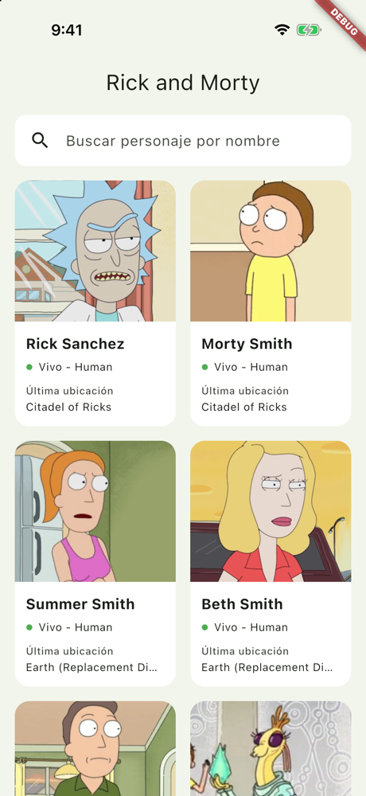
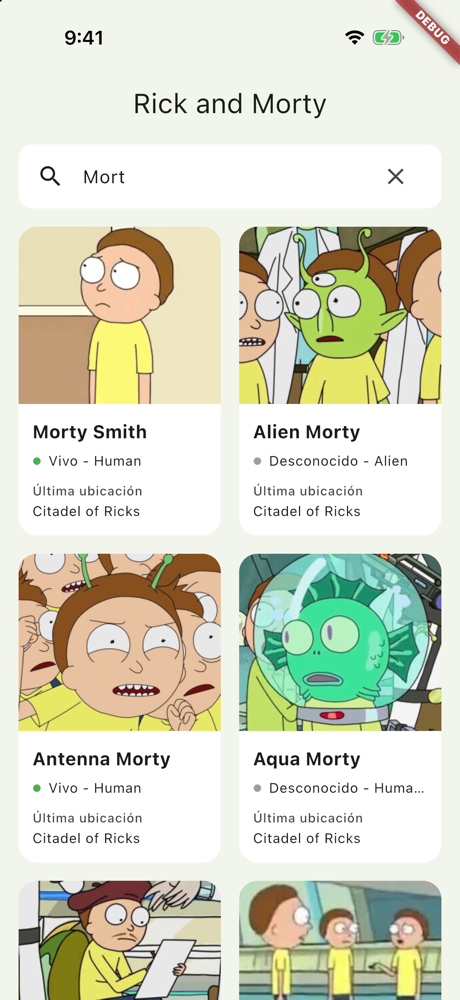
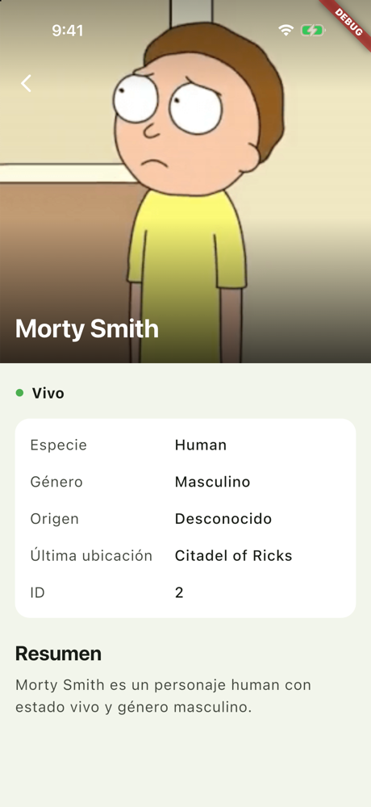

# Portal Remoto

App Flutter (Android e iOS) para **buscar personajes de Rick and Morty por nombre** y ver su detalle, usando la [Rick and Morty API](https://rickandmortyapi.com/documentation).

- **Listado**: cuadrícula con scroll infinito (20 por página), búsqueda por nombre con *debounce* de 500 ms, *pull to refresh* y estados de carga, error y sin resultados.
- **Detalle**: imagen, estado, especie, tipo, género, origen, última ubicación e ID.

| Personajes | Búsqueda | Detalle |
|---|---|---|
|  |  |  |

## Cómo correrlo

Requisitos: Flutter `3.47.x` (Dart `^3.13.4`), Xcode + CocoaPods para iOS o Android SDK para Android. No hace falta API key.

```bash
flutter pub get
flutter run --flavor dev
```

| Flavor | Datos |
|---|---|
| `mock` | Personajes en memoria (`CharacterRepositoryMock`), sin red. |
| `dev` | API real. |
| `prod` | API real (es el que se usa si no se pasa `--flavor`). |

Tests: `flutter test`.

## API

Base: `https://rickandmortyapi.com/api`

| Uso | Endpoint | Notas |
|---|---|---|
| Listado y búsqueda | `GET /character?page={n}&name={texto}` | `name` solo se envía si hay texto. `info.pages` indica la última página. Un `404` significa "sin resultados" y se muestra como lista vacía. |
| Detalle | `GET /character/{id}` | Un `404` se muestra como "No se encontró el personaje". Si el personaje ya llegó en el listado, se toma de la caché en memoria sin otra petición. |
| Imágenes | `image` de cada personaje (`/character/avatar/{id}.jpeg`) | Se cargan con `Image.network`. |

Errores de red: un `TimeoutException` (30 s) se muestra como "La solicitud tardó demasiado"; un `SocketException` o `ClientException` como "Sin conexión a internet".

## Estructura

```
lib/
├── domain/        # Entidades, contratos de repositorio, casos de uso y claves de error
├── data/          # RestApi (http), DTO y repositorios (API real y mock)
├── presentation/  # Páginas (Page + Screen + ViewModel), widgets, tema y textos
├── dependency_injection.dart  # Providers de Riverpod
└── main.dart
```

`domain` no depende de las otras capas. Los repositorios reciben el `RestApi` por constructor y los providers se arman con `ref.watch`, así que en un test se pueden sobrescribir con `ProviderScope(overrides: [...])`. Los textos están en `assets/translate_dictionaries/es.json`.

## Dependencias

| Paquete | Por qué |
|---|---|
| `flutter_riverpod` | Inyección de dependencias y `AsyncValue` para los estados de carga, error y datos. |
| `http` | Peticiones a la API; en los tests se cambia el cliente con `MockClient`. |
| `go_router` | Rutas declarativas con parámetros (`/characters/:id`). Con `Navigator` habría que parsear la ruta y armar el `MaterialPageRoute` a mano, y deja la app lista para deep links. |
| `flutter_flavorizr` (dev) | Generó la configuración de los flavors en Android e iOS (ids, nombres, esquemas de Xcode). Es de desarrollo, no llega a la app, y se mantiene para regenerar esa configuración si cambia un flavor. |

## Limitaciones

- Solo Android e iOS, y solo en español. Los datos de la API (especie, tipo, lugares) vienen en inglés y se muestran tal cual.
- La caché de personajes es en memoria: se pierde al cerrar la app y no sirve sin conexión.
- La API limita las peticiones (Cloudflare responde `error code: 1015`); si pasa, se muestra "No pudimos cargar los personajes" con el botón de reintentar.

Cambios: [CHANGELOG.md](CHANGELOG.md).
