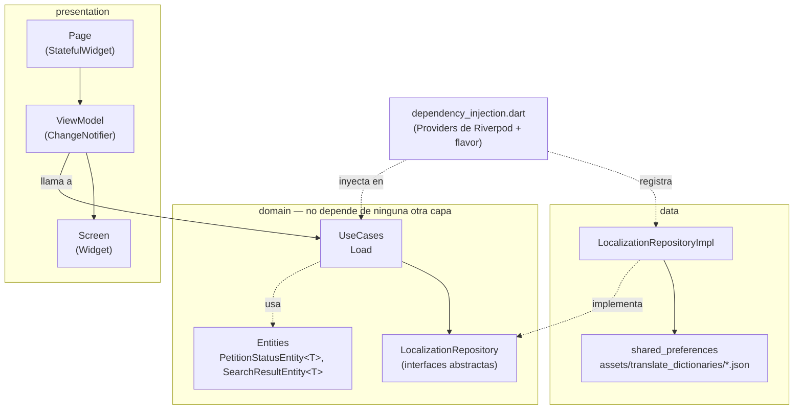

# Portal Remoto

App Flutter de **portal remoto**. Por ahora el proyecto tiene la base de arquitectura lista (splash, localización, widgets de carga y flavors) y todavía no tiene funcionalidades de negocio.

## ¿Qué hace?

- **Splash**: carga las traducciones y la versión de la app, y luego navega a la pantalla principal.
- **Pantalla principal**: hoy es un `PlaceholderPage`, que se reemplazará por la primera funcionalidad.

Proyecto construido con **Clean Architecture** (domain / data / presentation), MVVM en la capa de presentación, **Riverpod** para estado global e inyección de dependencias, **go_router** para la navegación y **flavors** (`mock`, `dev` y `prod`).

## Capturas

_Pendiente: se agregarán en `docs/screenshots/` cuando existan las primeras pantallas._

## Requisitos previos

| Herramienta | Versión |
|---|---|
| Flutter | `3.47.x` (canal stable; desarrollado con `3.47.7`) |
| Dart SDK | `^3.13.4` (definido en `pubspec.yaml`) |
| Xcode + CocoaPods | Solo para correr en iOS |
| Android Studio / Android SDK | Solo para correr en Android |

Verificar el entorno con:

```bash
flutter doctor
```

No se necesita ningún API key ni archivo `.env`.

## Cómo ejecutarlo

1. Clonar el repositorio:

   ```bash
   git clone https://github.com/marlonc98/pragma_road_2.git
   cd pragma_road_2
   ```

2. Instalar dependencias (como `pubspec.lock` no se versiona, este paso resuelve las versiones según los rangos de `pubspec.yaml`):

   ```bash
   flutter pub get
   ```

3. Correr la app con un flavor:

   ```bash
   flutter run --flavor mock
   ```

   En VS Code también se puede elegir el flavor desde **Run and Debug**: [.vscode/launch.json](.vscode/launch.json) tiene una configuración por flavor.

### Flavors

| Flavor | Nombre de la app | Notas |
|---|---|---|
| `mock` | [MOCK] Portal Remoto | Pensado para repositorios en memoria con datos de ejemplo. |
| `dev` | [DEV] Portal Remoto | Ambiente de desarrollo. |
| `prod` | Portal Remoto | Ambiente de producción. |

Cada flavor tiene su propio `applicationId` / `bundleId` (`.mock`, `.dev`), así que los tres se pueden instalar a la vez. Si se corre sin `--flavor`, la app usa `prod`. El repositorio de cada flavor se elige en [dependency_injection.dart](lib/dependency_injection.dart) con un `switch (F.appFlavor)`.

## Cómo contribuir

Los commits siguen [Conventional Commits](https://www.conventionalcommits.org/) en inglés (`feat(auth): ...`, `fix(splash): ...`). Antes de abrir un PR:

```bash
dart format lib test
flutter analyze
flutter test
```

## Estructura de carpetas y arquitectura

El código en `lib/` está organizado en tres capas, siguiendo la regla de dependencia de Clean Architecture: `domain` no conoce a `data` ni a `presentation`; las otras dos capas dependen de `domain`, nunca al revés.



```
lib/
├── domain/              # Reglas de negocio puras, sin Flutter ni detalles de almacenamiento
│   ├── entities/         # PetitionStatusEntity<T>, SearchResultEntity<T>
│   ├── repositories/     # Contratos abstractos (LocalizationRepository)
│   ├── use_cases/        # Una operación de negocio por clase (load_use_case.dart)
│   ├── states/           # Contrato de estado global (LocalizationState)
│   └── constants/        # Claves de error compartidas (ErrorsConstants)
│
├── data/                # Implementaciones concretas de los contratos de domain
│   └── repositories/
│       └── localization/  # LocalizationRepositoryImpl + api/
│
├── presentation/        # UI + estado de UI
│   ├── pages/            # Cada pantalla: Page + Screen + ViewModel (+ widgets/ propios)
│   │   ├── splash/        # Carga traducciones y versión, luego va a la pantalla principal
│   │   └── placeholder/   # Pantalla temporal hasta tener la primera funcionalidad
│   ├── widgets/          # Reutilizables: buttons/, images/ y loaders_status/ (carga, error, sin resultados)
│   ├── states/           # Implementación Riverpod de LocalizationState
│   ├── utils/            # ViewModel base + StfViewModelAdapter
│   ├── theme/            # Tema de la app (pendiente)
│   ├── constants/        # TextConstants (claves de traducción)
│   ├── router.dart       # Rutas con go_router
│   └── app.dart          # MaterialApp.router
│
├── flavors/flavors.dart       # Flavor actual y nombre de la app por flavor
├── dependency_injection.dart  # Todos los Providers (repositorios, estados y casos de uso)
└── main.dart                  # Punto de entrada: lee el flavor y envuelve la app en ProviderScope

assets/translate_dictionaries/  # Traducciones (es.json)
test/                           # Tests
```

### Capas

- **domain**: define *qué* hace la app. Los casos de uso aplican las reglas de negocio sin saber de dónde vienen los datos.
- **data**: define *cómo* se obtienen y guardan los datos. Cambiar la fuente (local, API, mock) solo requiere otra implementación del repositorio y cambiar su Provider.
- **presentation**: dibuja la UI y reacciona a los cambios. Los `ViewModel` llaman casos de uso a través de los Providers, nunca a los repositorios directamente.

### Inyección de dependencias con Riverpod

[dependency_injection.dart](lib/dependency_injection.dart) declara todos los `Provider`/`NotifierProvider`, agrupados en repositorios, estados y casos de uso. Cuando un repositorio tenga versión mock, su Provider elige la implementación según el flavor.

### Patrón de cada pantalla (Page / Screen / ViewModel)

- **`*_page.dart`**: `StatefulWidget` con su `route` estática; solo crea el `ViewModel` vía `StfViewModelAdapter`.
- **`*_page_view_model.dart`**: extiende `ViewModel<T>` (un `ChangeNotifier` con acceso a `context` y `WidgetRef`), llama a los casos de uso y expone el estado a la UI.
- **`*_page_screen.dart`**: widget que recibe el `ViewModel` y solo dibuja UI.

### Manejo de resultados asíncronos: `PetitionStatusEntity<T>`

Los repositorios devuelven [PetitionStatusEntity<T>](lib/domain/entities/petition_status_entity.dart): un wrapper con `status` (`notStarted` / `loading` / `complete` / `failed`), `data` y `error`. Los errores se muestran traducidos a partir de las claves de [ErrorsConstants](lib/domain/constants/errors_constants.dart).

### Widgets de estado de carga

[LoaderScreenWidget<T>](lib/presentation/widgets/loaders_status/loader_screen_widget.dart) recibe un `PetitionStatusEntity<T>` y decide qué dibujar:

- `loading` → `LoadingWidget`.
- `complete` sin datos (lista, mapa o `SearchResultEntity` vacíos) y `noResultsScreen: true` → `NoResultsWidget` o `NoResultsSmallWidget` (con `noResultsSmall: true`), o un `customNoResults`.
- `failed`, o sin datos cuando `allowNull` es `false` → `ErrorLoadingWidget` con el error traducido y el botón de reintentar.
- `complete` con datos → llama a `builder(context, data)`.

`fullSize` controla cómo se centra el estado (`inContainer`, `inExpanded` o `notFullSize`).

### Imágenes

[ImageNetworkWithLoadWidget](lib/presentation/widgets/images/image_network_with_load_widget.dart) carga una imagen desde una URL (`http`/`https`), un asset (`assets/`) o un archivo local. Muestra un indicador mientras carga y, si falla, una imagen por defecto (`defaultImage`) o un placeholder; con `notShowDefaultImage: true` no muestra nada.

### Internacionalización

> **Hoy la app está solo en español (`es`).**

Los textos visibles usan claves de [TextConstants](lib/presentation/constants/text_constants.dart), y las traducciones viven en `assets/translate_dictionaries/<locale>.json`. Al agregar un texto nuevo, la clave debe ir en `TextConstants` y en **cada** JSON de idioma.

## Paquetes principales

| Paquete | Para qué se usa | Por qué está |
|---|---|---|
| `flutter_riverpod` / `riverpod` | Estado global e inyección de dependencias | Es el mecanismo central de la arquitectura: repositorios, estados y casos de uso se declaran como Providers. |
| `go_router` | Navegación | Rutas declarativas (`context.go` / `context.push`). |
| `shared_preferences` | Persistencia local de clave-valor | La usa la localización para el idioma guardado. |
| `package_info_plus` | Leer la versión y el número de build | Se muestran en el splash (`Versión {version} ({build})`). |
| `flutter_flavorizr` (dev) | Generar los flavors `mock`, `dev` y `prod` | Configura Android e iOS (ids, nombres, esquemas de Xcode) desde `pubspec.yaml`. Está configurado para no tocar `main.dart`, `app.dart` ni los íconos. |
| `flutter_test`, `flutter_lints` (dev) | Tests y reglas de análisis estático | |

## Archivos que no se versionan

El [.gitignore](.gitignore) excluye todo lo que es local a la máquina o sensible:

- **Generados / locales**: `build/`, `.dart_tool/`, `.idea/`, `*.iml`, `.metadata`, `pubspec.lock`, `Podfile.lock`, `Pods/`, `xcuserdata/`, `local.properties`, `.vscode/settings.json`.
- **Credenciales**: `.env` / `.env.*` (se permite `.env.example`), `key.properties`, keystores (`*.jks`, `*.keystore`), certificados y perfiles de iOS (`*.p12`, `*.p8`, `*.mobileprovision`), `google-services.json` y `GoogleService-Info.plist`.

## Limitaciones conocidas / próximos pasos

- La app está solo en español (`es`).
- La pantalla principal todavía es un `PlaceholderPage`.
- El tema de la app (`presentation/theme/`) aún no está definido.
