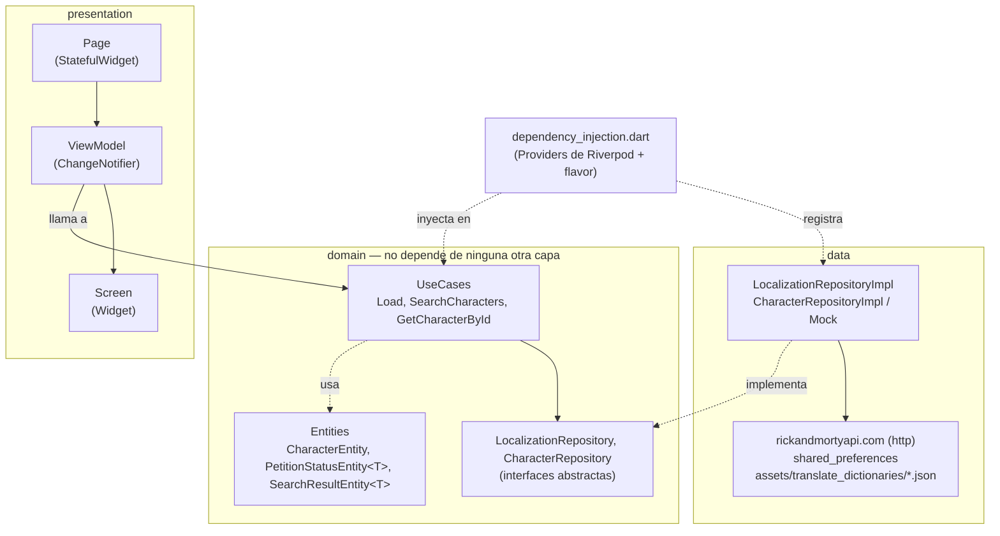

# Portal Remoto

App Flutter para **buscar personajes de Rick and Morty** y ver su detalle, usando la API pública [rickandmortyapi.com](https://rickandmortyapi.com/documentation).

## ¿Qué hace?

- **Splash**: carga las traducciones y la versión de la app, y luego navega al listado.
- **Personajes**: lista con scroll infinito (20 por página), búsqueda por palabra clave con *debounce*, *pull to refresh* y estados de carga, error y sin resultados.
- **Búsqueda por palabra clave**: el texto se busca en nombre, especie y tipo (coincidencia parcial). Si además es un estado o un género, en inglés o en español (`vivo`, `muerto`, `desconocido`, `mujer`, `masculino`, `sin género`…), también filtra por ese campo.
- **Detalle**: imagen, estado, género, número de episodios, especie, tipo, origen y última ubicación conocida.

Proyecto construido con **Clean Architecture** (domain / data / presentation), MVVM en la capa de presentación, **Riverpod** para estado global e inyección de dependencias, **go_router** para la navegación y **flavors** (`mock`, `dev` y `prod`).

## Capturas

_Pendiente: se agregarán en `docs/screenshots/` cuando existan las primeras pantallas._

## Requisitos previos

| Herramienta | Versión |
|---|---|
| Flutter | `3.47.x` (canal stable; desarrollado con `3.47.7`) |
| Dart SDK | `^3.13.4` (definido en `pubspec.yaml`) |
| Xcode + CocoaPods | Solo para correr en iOS |
| Android Studio / Android SDK | Solo para correr en Android |

Verificar el entorno con:

```bash
flutter doctor
```

No se necesita ningún API key ni archivo `.env`.

## Cómo ejecutarlo

1. Clonar el repositorio:

   ```bash
   git clone https://github.com/marlonc98/pragma_road_2.git
   cd pragma_road_2
   ```

2. Instalar dependencias (como `pubspec.lock` no se versiona, este paso resuelve las versiones según los rangos de `pubspec.yaml`):

   ```bash
   flutter pub get
   ```

3. Correr la app con un flavor:

   ```bash
   flutter run --flavor mock
   ```

   En VS Code también se puede elegir el flavor desde **Run and Debug**: [.vscode/launch.json](.vscode/launch.json) tiene una configuración por flavor.

### Flavors

| Flavor | Nombre de la app | Notas |
|---|---|---|
| `mock` | [MOCK] Portal Remoto | Personajes en memoria (`CharacterRepositoryMock`), sin llamar a la API. |
| `dev` | [DEV] Portal Remoto | API real. |
| `prod` | Portal Remoto | API real. |

Cada flavor tiene su propio `applicationId` / `bundleId` (`.mock`, `.dev`), así que los tres se pueden instalar a la vez. Si se corre sin `--flavor`, la app usa `prod`. El repositorio de cada flavor se elige en [dependency_injection.dart](lib/dependency_injection.dart) con un `switch (F.appFlavor)`.

## Cómo contribuir

Los commits siguen [Conventional Commits](https://www.conventionalcommits.org/) en inglés (`feat(auth): ...`, `fix(splash): ...`). Antes de abrir un PR:

```bash
dart format lib test
flutter analyze
flutter test
```

## Estructura de carpetas y arquitectura

El código en `lib/` está organizado en tres capas, siguiendo la regla de dependencia de Clean Architecture: `domain` no conoce a `data` ni a `presentation`; las otras dos capas dependen de `domain`, nunca al revés.



```
lib/
├── domain/              # Reglas de negocio puras, sin Flutter ni detalles de almacenamiento
│   ├── entities/         # CharacterEntity, PetitionStatusEntity<T>, SearchResultEntity<T>
│   ├── repositories/     # Contratos abstractos (LocalizationRepository, CharacterRepository)
│   ├── use_cases/        # Una operación de negocio por clase (load, character/search, character/get_by_id)
│   ├── states/           # Contrato de estado global (LocalizationState)
│   └── constants/        # Claves de error compartidas (ErrorsConstants)
│
├── data/                # Implementaciones concretas de los contratos de domain
│   ├── settings/         # RestApi (cliente http + manejo de errores) y RickAndMortyApi
│   ├── dtos/             # CharacterDto: JSON de la API -> CharacterEntity
│   └── repositories/
│       ├── character/     # CharacterRepositoryImpl (API), CharacterRepositoryMock + api/
│       └── localization/  # LocalizationRepositoryImpl + api/
│
├── presentation/        # UI + estado de UI
│   ├── pages/            # Cada pantalla: Page + Screen + ViewModel (+ widgets/ propios)
│   │   ├── splash/            # Carga traducciones y versión, luego va al listado
│   │   ├── characters/        # Listado paginado con búsqueda (+ widgets/character_card_widget.dart)
│   │   └── character_detail/  # Detalle de un personaje por id
│   ├── widgets/          # Reutilizables: buttons/, images/, inputs/, lists/ y loaders_status/
│   ├── states/           # Implementación Riverpod de LocalizationState
│   ├── utils/            # ViewModel base, StfViewModelAdapter y textos/colores de estado y género
│   ├── theme/            # AppTheme (claro y oscuro)
│   ├── constants/        # TextConstants (claves de traducción)
│   ├── router.dart       # Rutas con go_router
│   └── app.dart          # MaterialApp.router
│
├── flavors/flavors.dart       # Flavor actual y nombre de la app por flavor
├── dependency_injection.dart  # Todos los Providers (repositorios, estados y casos de uso)
└── main.dart                  # Punto de entrada: lee el flavor y envuelve la app en UncontrolledProviderScope(container: di)

assets/translate_dictionaries/  # Traducciones (es.json)
test/                           # Tests
```

### Capas

- **domain**: define *qué* hace la app. Los casos de uso aplican las reglas de negocio sin saber de dónde vienen los datos.
- **data**: define *cómo* se obtienen y guardan los datos. Las funciones de `api/` hacen la petición con `di.read(rickAndMortyApiProvider)` y lanzan claves de `ErrorsConstants`; el repositorio las envuelve en `PetitionStatusEntity`. Cambiar la fuente (API, mock) solo requiere otra implementación del repositorio y cambiar su Provider.
- **presentation**: dibuja la UI y reacciona a los cambios. Los `ViewModel` llaman casos de uso a través de los Providers, nunca a los repositorios directamente.

### Inyección de dependencias con Riverpod

[dependency_injection.dart](lib/dependency_injection.dart) declara todos los `Provider`/`NotifierProvider`, agrupados en APIs, repositorios, estados y casos de uso. También expone `di`, un `ProviderContainer` global que la app comparte con `UncontrolledProviderScope` en `main.dart`: los widgets y ViewModels leen con `ref`, y el código sin `ref` (las funciones de `data/.../api/`) lee el mismo contenedor con `di.read(...)`, así que todos usan las mismas instancias. `characterRepositoryProvider` elige la implementación según el flavor: `CharacterRepositoryMock` en `mock` y `CharacterRepositoryImpl` (API real) en `dev` y `prod`.

### Patrón de cada pantalla (Page / Screen / ViewModel)

- **`*_page.dart`**: `StatefulWidget` con su `route` estática; solo crea el `ViewModel` vía `StfViewModelAdapter`.
- **`*_page_view_model.dart`**: extiende `ViewModel<T>` (un `ChangeNotifier` con acceso a `context` y `WidgetRef`), llama a los casos de uso y expone el estado a la UI.
- **`*_page_screen.dart`**: widget que recibe el `ViewModel` y solo dibuja UI.

### Manejo de resultados asíncronos: `PetitionStatusEntity<T>`

Los repositorios devuelven [PetitionStatusEntity<T>](lib/domain/entities/petition_status_entity.dart): un wrapper con `status` (`notStarted` / `loading` / `complete` / `failed`), `data` y `error`. Los errores se muestran traducidos a partir de las claves de [ErrorsConstants](lib/domain/constants/errors_constants.dart).

### Widgets de estado de carga

[LoaderScreenWidget<T>](lib/presentation/widgets/loaders_status/loader_screen_widget.dart) recibe un `PetitionStatusEntity<T>` y decide qué dibujar:

- `loading` → `LoadingWidget`.
- `complete` sin datos (lista, mapa o `SearchResultEntity` vacíos) y `noResultsScreen: true` → `NoResultsWidget` o `NoResultsSmallWidget` (con `noResultsSmall: true`), o un `customNoResults`.
- `failed`, o sin datos cuando `allowNull` es `false` → `ErrorLoadingWidget` con el error traducido y el botón de reintentar.
- `complete` con datos → llama a `builder(context, data)`.

`fullSize` controla cómo se centra el estado (`inContainer`, `inExpanded` o `notFullSize`).

### Búsqueda por palabra clave

La API solo combina filtros con Y (`name=rick&species=human`), así que [SearchCharactersUseCase](lib/domain/use_cases/character/search_characters_use_case.dart) arma un `CharacterFilterEntity` por campo y pide la misma página de cada uno en paralelo. Junta los resultados en orden de prioridad (nombre, especie, tipo, estado, género) y descarta un personaje si ya coincide con un filtro anterior; así nadie se repite, ni dentro de una página ni entre páginas. `lastpage` es la mayor de las búsquedas.

### Caché y conexión

- **Personajes**: `CharacterRepositoryImpl` guarda en memoria cada personaje que llega en una búsqueda o en un detalle. Abrir el detalle desde la lista no hace otra petición.
- **Imágenes**: `ImageNetworkWithLoadWidget` con `useCache: true` usa `CachedNetworkImageProvider`, que las guarda en disco.
- **Timeout**: si una petición tarda más de 30 s, `RestApi.hasInternetConnection()` revisa la conexión con `connectivity_plus` para mostrar "Sin conexión a internet" o "La solicitud tardó demasiado".

### Tests

```bash
flutter test
```

Cubren el `CharacterDto`, el `CharacterRepositoryImpl` contra un `MockClient` de `http` (parámetros de cada filtro, 404 como lista vacía o `characterNotFound`, errores de red y caché), el timeout de `RestApi` con y sin conexión, y la búsqueda por palabra clave sobre el repositorio mock.

### Imágenes

[ImageNetworkWithLoadWidget](lib/presentation/widgets/images/image_network_with_load_widget.dart) carga una imagen desde una URL (`http`/`https`), un asset (`assets/`) o un archivo local. Muestra un indicador mientras carga y, si falla, una imagen por defecto (`defaultImage`) o un placeholder; con `notShowDefaultImage: true` no muestra nada.

### Internacionalización

> **Hoy la app está solo en español (`es`).**

Los textos visibles usan claves de [TextConstants](lib/presentation/constants/text_constants.dart), y las traducciones viven en `assets/translate_dictionaries/<locale>.json`. Al agregar un texto nuevo, la clave debe ir en `TextConstants` y en **cada** JSON de idioma.

## Paquetes principales

| Paquete | Para qué se usa | Por qué está |
|---|---|---|
| `flutter_riverpod` / `riverpod` | Estado global e inyección de dependencias | Es el mecanismo central de la arquitectura: repositorios, estados y casos de uso se declaran como Providers. |
| `go_router` | Navegación | Rutas declarativas (`context.go` / `context.push`); el detalle usa la ruta `/characters/:id`. |
| `http` | Peticiones a la API | Lo usa `RestApi`. `RickAndMortyApi` (un `RestApi`) se registra en `rickAndMortyApiProvider` y las funciones de `api/` lo leen con `di.read(rickAndMortyApiProvider)`. En los tests se cambia el cliente con `http.runWithClient` + `MockClient`. |
| `cached_network_image` | Caché de imágenes en disco | Evita volver a descargar las imágenes de los personajes. |
| `connectivity_plus` | Saber si hay red | Ante un timeout, distingue "sin internet" de "tardó demasiado". |
| `infinite_scroll_pagination` | Scroll infinito del listado | `PagingController` + `PagedListView` piden la siguiente página hasta llegar a `info.pages`. |
| `shared_preferences` | Persistencia local de clave-valor | La usa la localización para el idioma guardado. |
| `package_info_plus` | Leer la versión y el número de build | Se muestran en el splash (`Versión {version} ({build})`). |
| `flutter_flavorizr` (dev) | Generar los flavors `mock`, `dev` y `prod` | Configura Android e iOS (ids, nombres, esquemas de Xcode) desde `pubspec.yaml`. Está configurado para no tocar `main.dart`, `app.dart` ni los íconos. |
| `flutter_test`, `flutter_lints` (dev) | Tests y reglas de análisis estático | |

## Archivos que no se versionan

El [.gitignore](.gitignore) excluye todo lo que es local a la máquina o sensible:

- **Generados / locales**: `build/`, `.dart_tool/`, `.idea/`, `*.iml`, `.metadata`, `pubspec.lock`, `Podfile.lock`, `Pods/`, `xcuserdata/`, `local.properties`, `.vscode/settings.json`.
- **Credenciales**: `.env` / `.env.*` (se permite `.env.example`), `key.properties`, keystores (`*.jks`, `*.keystore`), certificados y perfiles de iOS (`*.p12`, `*.p8`, `*.mobileprovision`), `google-services.json` y `GoogleService-Info.plist`.

## Limitaciones conocidas / próximos pasos

- La app está solo en español (`es`); los valores que vienen de la API (especie, tipo, lugares) se muestran tal cual, en inglés.
- La caché de personajes es solo en memoria: se pierde al cerrar la app y no permite usarla sin conexión.
- `connectivity_plus` sabe si hay red, no si esa red tiene salida a internet; con un wifi sin internet se muestra "tardó demasiado".
